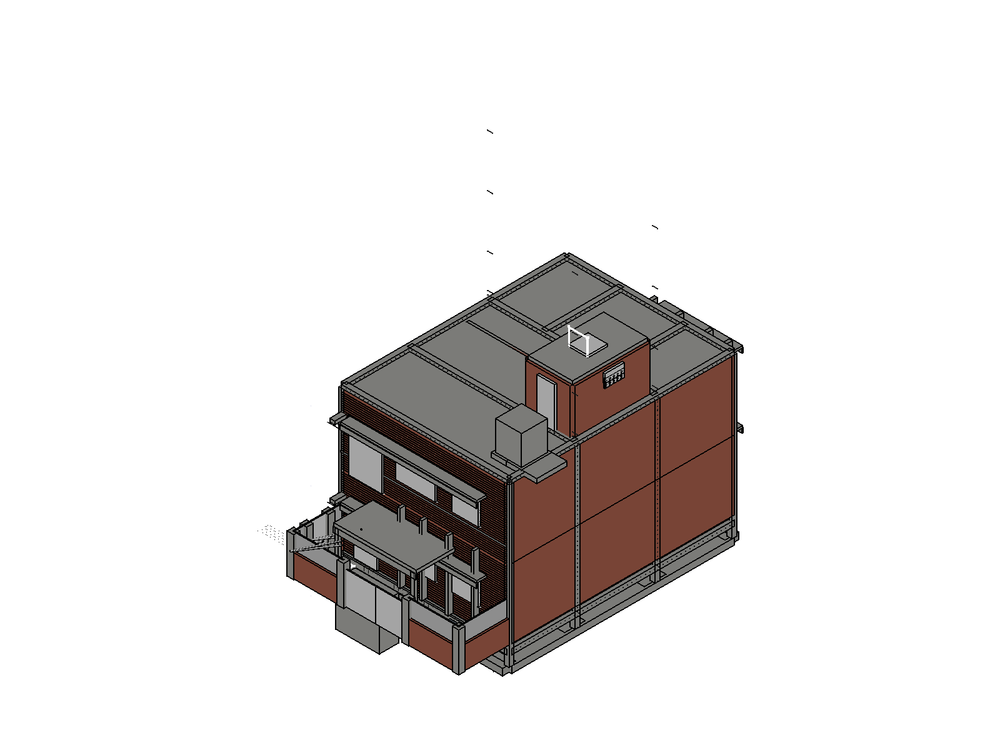

# FreeCAD Claude House Designer

**Connect Claude (Anthropic's AI) to FreeCAD via MCP and design a real, structurally-verified house from natural language.** This repo contains a complete, working example: a 5-marla (25×45 ft) residential house designed for Islamabad, Pakistan, built entirely through a live Claude ↔ FreeCAD connection — plus the full **17-skill Claude skill library** for house/BIM design that you can drop into your own Claude Code setup and reuse for any project.

If you're searching for *"how to connect FreeCAD with Claude AI"*, *"Claude Code FreeCAD MCP"*, *"AI house design tool"*, *"FreeCAD BIM automation"*, or *"AI structural engineering skills for architects"* — this is a real, end-to-end reference implementation, not a toy demo.



## What's in this repo

| Folder | What it is |
|---|---|
| [`skills/`](skills/) | 17 Claude Code skills covering the full residential design/engineering stack: spatial planning, structural systems, seismic design, geotechnical/foundations, concrete & rebar detailing, masonry, roofing/waterproofing, MEP coordination, stairs, openings/lintels, timber/steel framing, construction sequencing, cost estimation, building codes/permits, accessibility, building typology, and the FreeCAD/BIM modeling skill itself |
| [`model/`](model/) | The actual FreeCAD file (`.FCStd`) — a real, live BIM model with 700+ parametric objects: walls, footings, tie columns, rebar cages, doors/windows, MEP piping, a septic system, an electrical panel with a real circuit schedule, and a boundary wall/gate |
| [`docs/`](docs/) | The full design document (climate strategy, passive cooling, structural concept, material palette, cost strategy) and a real build log documenting what was built, what broke, and how it was fixed |
| [`images/`](images/) | Real renders exported directly from the FreeCAD model |

## Why this exists

Most "AI + CAD" demos stop at generating a pretty box. This project pushes further: every claim in this repo is backed by something verifiable in the live model — wall openings verified by volume-diff, footings sized by an actual load takedown and bearing-capacity check, reinforcement verified against ACI 318-19 minimum-steel ratios, and select members run through a real CalculiX FEM solve via `mcp__freecad__run_fem_analysis`. When something failed — a broken staircase, a corrupted door property, a mesh that hung the solver — it's documented in [`docs/WORK_LOG.md`](docs/WORK_LOG.md) instead of hidden.

**This produced real, non-obvious engineering findings**, including:
- A staircase that was geometrically broken in three places, traced to a misunderstood `Arch.makeStairs` rotation convention, rebuilt and re-verified from scratch
- A footing found to physically clash with an underground water tank (caught via solid-intersection volume, not visual inspection) and corrected
- A requested 9×18ft parking bay that genuinely does not fit a real 5-marla plot once setbacks and an existing veranda are accounted for — reported honestly instead of mislabeling a smaller space
- Several previously-undocumented FreeCAD API gotchas (see below) now written into the skill files so the next person doesn't have to rediscover them

## Quick start — connect Claude to FreeCAD yourself

1. Install [FreeCAD 1.0+](https://www.freecad.org/) and the [`freecad-mcp`](https://pypi.org/project/freecad-mcp/) bridge (`uvx freecad-mcp` or `pip install freecad-mcp`).
2. Launch FreeCAD on a real display (not a headless Xvfb — the RPC bridge needs a live GUI event loop).
3. Register the MCP server with Claude Code:
   ```bash
   claude mcp add freecad -- uvx freecad-mcp
   ```
4. Copy the [`skills/`](skills/) folder into your project's `.claude/skills/` directory.
5. Open Claude Code in your project and ask it to design a house — it will load `architecture-freecad-bim` automatically and start modeling.

## The skill library

Each skill is a single `SKILL.md` file — dense, numeric, code-cited reference material (not vague prose) covering one discipline. They're calibrated primarily to **Pakistani building practice** (Building Code of Pakistan, marla/kanal plot geometry, confined masonry construction) with **ACI 318-19 / ASCE 7-22 / IRC 2021** as deep-detail cross-references for anywhere local documentation is thin — but the underlying physics, FreeCAD techniques, and structural methodology apply anywhere.

- **`architecture-freecad-bim`** — the core modeling skill: spatial hierarchy (Site/Building/Storey), parametric wall openings via void-extrusion + Subtractions, real rebar cages via `Arch.makeRebar`, and actual structural verification through the CalculiX FEM pipeline. **Read this first.**
- **`architecture-spatial-planning`**, **`architecture-building-typology`** — turning a plot into a dimensionally defensible floor plan
- **`architecture-structural-systems`**, **`architecture-seismic-design`**, **`architecture-geotechnical-foundations`**, **`architecture-concrete-reinforcement-detailing`** — the engineering core
- **`architecture-masonry-materials`**, **`architecture-roofing-waterproofing`**, **`architecture-openings-lintels-detailing`**, **`architecture-stairs-vertical-circulation`**, **`architecture-timber-steel-framing`** — construction detailing
- **`architecture-mep-coordination`**, **`architecture-construction-sequencing`**, **`architecture-cost-estimation-boq`** — coordination and delivery
- **`architecture-building-codes-permits`**, **`architecture-accessibility-design`** — regulatory and inclusive design

### FreeCAD API gotchas discovered building this project

These cost real debugging time and are now documented in [`skills/architecture-freecad-bim/SKILL.md`](skills/architecture-freecad-bim/SKILL.md) so you don't have to rediscover them:

- `Arch.makeFloor`'s `Elevation` property is **derived from** `Placement.Base.z`, not the other way round — setting `Elevation` directly silently reverts on recompute.
- `Arch.makeStructure`'s axis-centering convention **depends on `IfcType`**: Column/Slab types center the plan footprint and corner-base the height; Beam/Footing types corner-base the length and center the cross-section. Assuming one convention for both silently misplaces geometry.
- `Arch.makeRebar`'s `Direction` property defaults to zero and must be set explicitly, or bar spacing computes against a degenerate value instead of the host's real length.
- `Arch.makeStairs`'s `length`/`width` map to local X/Y in a way that depends on the rotation applied — verify every flight's `Shape.BoundBox` immediately after placement rather than trusting the parameters.
- Hand-setting a `Window`/`Door` object's `Normal` property (to fix a plan-view swing-symbol direction) corrupts its internal shape rebuild (`ValueError: Null shape` in `ArchWindow.buildShapes`) — that property isn't meant to be overridden directly.
- An unconstrained FEM mesh on a large, thin cantilevered member (like a chajja/sunshade) can generate hundreds of thousands of elements and hang the solver indefinitely with no clean cancel path — always cap `CharacteristicLengthMax` explicitly for thin members.
- `Arch.makeRebar`'s default 30mm `OffsetStart`/`OffsetEnd`, plus a closed stirrup's own bar radius poking past a flush end, can make correctly-placed rebar fail a naive bounding-box containment check — the tolerance needs to account for bar diameter, not just a flat few-mm margin.
- A `Door`/`Window` object's `Base` sketch `Placement` has **zero effect** on the built 3D shape — only the object's own `Placement` does. A door "fixed" by reverting a crash-causing `Normal` property back to its default can still build lying flat (like a downward-facing skylight) instead of standing upright in its wall opening — always re-verify with `Shape.BoundBox` against the actual `Void_*` opening, not just "no longer null."

## ⚠️ Reality check — read this before building anything from this repo

**Nothing in this repository is construction-ready.** Every structural member size, reinforcement schedule, and material spec here is a **conceptual/preliminary design aid**, not an engineering deliverable. Before any of this is used to build a real, occupied building:

1. A **licensed structural engineer** (PEC-registered in Pakistan, or the equivalent registered professional elsewhere) must review and stamp the structural design.
2. A **site-specific geotechnical investigation** must replace every assumed soil-bearing-capacity value in this model.
3. The design must go through **local authority plan approval** (LDA/CDA/RDA/TMA or equivalent) against the current, dated bylaw schedule for the actual plot — every coverage/setback/FAR figure used here is explicitly flagged as a placeholder pending that confirmation.
4. Reinforcement, FEM verification, and MEP coverage in the current model are **partial, not exhaustive** — see [`docs/WORK_LOG.md`](docs/WORK_LOG.md) for exactly which members have been checked and which have not.

This project is a demonstration of what an AI + parametric-CAD workflow can responsibly produce at the planning stage — and, just as importantly, of how it should communicate its own limits.

## License

Skills and documentation: MIT. FreeCAD model: CC-BY-4.0 (attribution appreciated if you build on this house design).

## Contributing

Found a bug in a skill, have a FreeCAD gotcha of your own, or extended this to a different plot/climate/code jurisdiction? PRs welcome — especially additions to the "gotchas" list above, since that's exactly the kind of hard-won knowledge this repo exists to accumulate.
